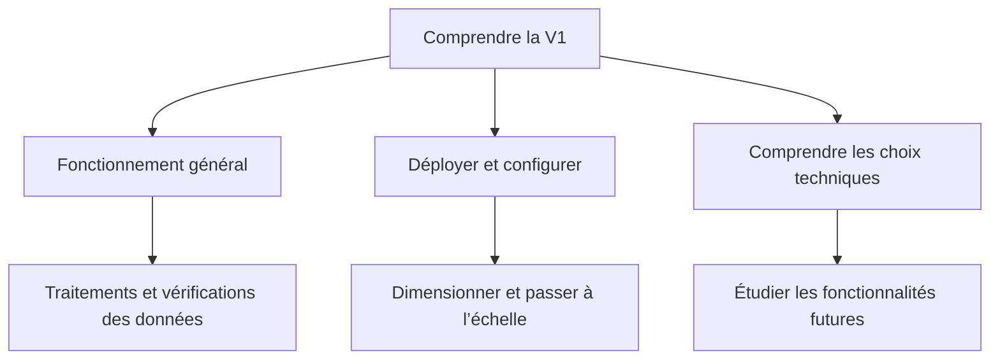

# Documentation V1

Commencer par le [README du projet](../README.md) pour installer l’API sur Windows/Linux et appeler `/upload`.

| Guide | À lire pour… |
|---|---|
| [Fonctionnement](fonctionnement.md) | Suivre le parcours HTTP, la transaction et le modèle de données ; les règles détaillées sont référencées dans le guide suivant |
| [Données](donnees.md) | Comprendre lecture, mapping, normalisation, dates, rapprochement, historique et ajout d’un champ |
| [Exploitation](exploitation.md) | Déployer en production, configurer, gérer migrations/sauvegardes et distinguer échelle verticale/horizontale |
| [Choix et évolutions](choix_et_evolutions.md) | Comprendre outils et compromis, maintenir les dépendances et identifier les améliorations encore à réaliser |

Les diagrammes utilisent des blocs Mermaid, [rendus directement par GitHub](https://docs.github.com/en/get-started/writing-on-github/working-with-advanced-formatting/creating-diagrams). Cette documentation décrit l’état de la V1 ; les propositions futures sont explicitement identifiées.
