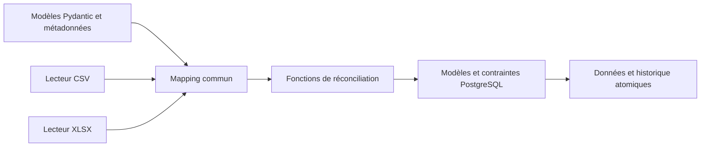
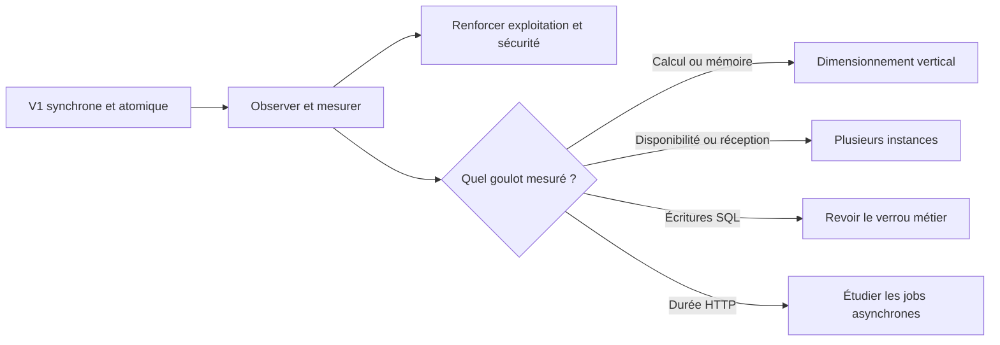

# Choix techniques et évolutions

[Sommaire](README.md) · [Fonctionnement](fonctionnement.md) · [Exploitation et échelle](exploitation.md)

## Technologies retenues

| Outil | Pourquoi il est utilisé | Compromis |
|---|---|---|
| Python 3.13 | Code commun Windows/Linux, annotations et bibliothèques de fichiers | Version déclarée dans `pyproject.toml`, venv propre par système |
| FastAPI + Uvicorn | HTTP, multipart, OpenAPI et routes synchrones | Le traitement occupe un thread pendant l’import ; pas de queue asynchrone |
| Pydantic 2 + email-validator | Contrat central, types et validations auprès des champs | Ne remplace pas les contraintes SQL ni les décisions sémantiques |
| `csv` + openpyxl + defusedxml | Chaînes CSV et types Excel conservés, lecture itérative et XML protégé | Les métadonnées/chaînes partagées XLSX peuvent consommer de la mémoire |
| charset-normalizer | Aide contrôlée aux encodages occidentaux, après BOM/UTF-8 strict | L’intention d’un encodage sans marque n’est jamais garantie pour tous les octets |
| PostgreSQL 17 | Relations, JSONB, `DATE`, unicité avec NULL et verrous transactionnels | La base est une dépendance obligatoire, avec sauvegardes à exploiter |
| SQLAlchemy 2 + psycopg 3 | Requêtes lisibles, session par requête, transactions et pool | Les limites de connexions doivent être dimensionnées entre processus/instances |
| Alembic | Historique reproductible du **schéma**, à partir de `0001_v1` | Une migration doit être relue ; ce n’est pas l’historique des valeurs métier |
| Docker + Compose | Même environnement Linux sur Windows/Linux, réseau, volumes et quotas | Les budgets sont par conteneur ; le volume ne constitue pas une sauvegarde |
| pip + setuptools et fichiers `.lock` | Paquet installable et versions Python exactes | Les tags système Docker ne sont pas figés par digest |
| Pytest + httpx / TestClient | Tests unitaires et intégration sur PostgreSQL réel | Les fichiers de référence restent locaux, sans données personnelles publiées |
| Black | Convention de formatage commune | Ni vérification de typage ni analyse de sécurité exhaustive |

Les versions exactes sont dans les deux `.lock`. `tzdata` est une dépendance de psycopg sous Windows uniquement. Aucun DataFrame, Redis, SQLite de travail, framework d’audit ou système de plugins n’est nécessaire au parcours actuel.

## Décisions de conception

Un module par responsabilité utile suffit au monolithe. Le lecteur ne connaît pas SQL ; les métadonnées de champs évitent de recopier les listes de contacts dans plusieurs couches. Les modèles canoniques et ORM restent distincts : règles d’import et stockage ne sont pas le même contrat.

La personne est recherchée puis comparée explicitement pour maîtriser non-effacement et historique. Un upsert opaque risquerait de masquer ces décisions. Pour le poste, l’upsert limité à « insérer si absent » correspond exactement au besoin. Le verrou PostgreSQL protège la réconciliation entre instances ; [ses limites de débit](exploitation.md#passage-à-léchelle) sont assumées.

L’atomicité par fichier évite les créations ou historiques partiels. Les traitements restent synchrones et bornés ; l’ajout d’une queue, d’un worker ou de commits par blocs demanderait de redéfinir reprise et idempotence, pas seulement de déplacer une fonction.

## Fonctionnalités possibles

Ce tableau décrit des **évolutions**, pas des fonctionnalités déjà livrées.

| Priorité / déclencheur | Évolution | Bénéfice et travail nécessaire |
|---|---|---|
| Avant exposition publique | Authentification et droits, TLS à l’entrée, quotas par client | Protéger les imports ; passerelle possible aujourd’hui, intégration applicative à concevoir |
| Avant exploitation durable | Métriques, alertes, sauvegardes et restauration testée, CI Windows/Linux | Mesurer délais/erreurs/verrous, sécuriser les livraisons et la reprise |
| Besoin de révocation immédiate | Annulation d’import et progression observables | Protocole d’annulation et contrôle du travail réellement interrompu |
| Volumes ou durées incompatibles avec HTTP synchrone | Jobs asynchrones avec file bornée et workers | Reprise et isolement ; nouveau contrat HTTP/statuts et politique de rétention nécessaires |
| Verrou global réellement limitant | Partitionnement des imports ou verrous par identité | Écritures concurrentes ; ordre de verrouillage, conflits d’organisation et deadlocks à traiter |
| Mesures SQL montrant trop d’allers-retours | Opérations par lots ou staging | Réduire les échanges tout en conservant compteurs, snapshots et rollback global |
| Identités plus fiables disponibles | Identifiants externes et référentiel d’organisations | Réduire les limites des homonymes ; règles de fusion à valider métier |
| Précision annuelle importante métier | Stocker année et précision séparément | Éviter le jour technique du 1er janvier ; migration et contrat à faire évoluer |
| Demande métier nouvelle | Nouveaux champs, effacement explicite ou audit des postes | Distinguer absence et demande d’effacement ; étendre schéma, historique et tests |

## Sources primaires

[FastAPI — fichiers](https://fastapi.tiangolo.com/tutorial/request-files/), [Pydantic — champs](https://docs.pydantic.dev/latest/concepts/fields/), [Python — csv](https://docs.python.org/3.13/library/csv.html), [openpyxl — lecture optimisée](https://openpyxl.readthedocs.io/en/stable/optimized.html), [charset-normalizer](https://charset-normalizer.readthedocs.io/en/latest/user/advanced_search.html), [SQLAlchemy — transactions](https://docs.sqlalchemy.org/en/20/orm/session_transaction.html), [PostgreSQL — contraintes](https://www.postgresql.org/docs/17/ddl-constraints.html), [Alembic](https://alembic.sqlalchemy.org/en/latest/tutorial.html), [Docker Compose](https://docs.docker.com/reference/compose-file/services/).

Ces documentations expliquent les mécanismes ; l’arborescence et les arbitrages ci-dessus sont propres au projet.
