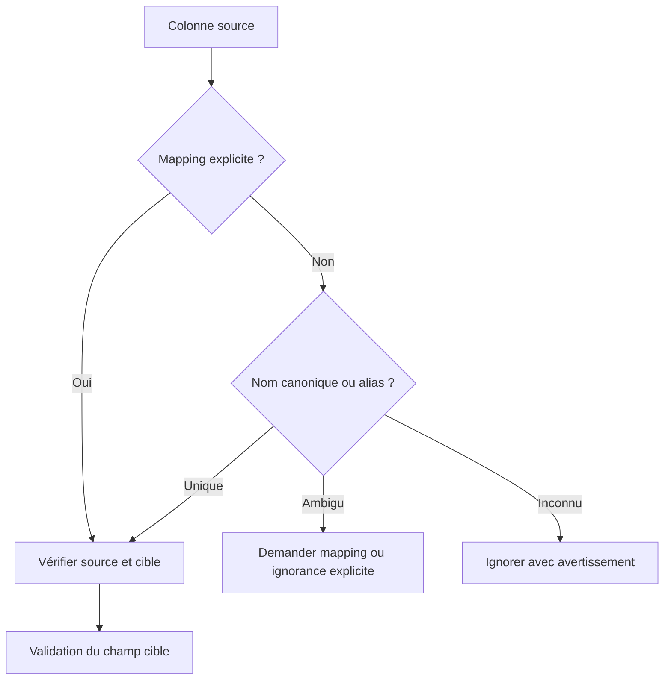
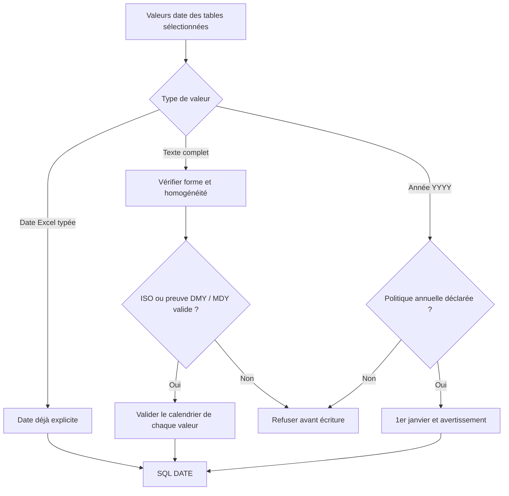
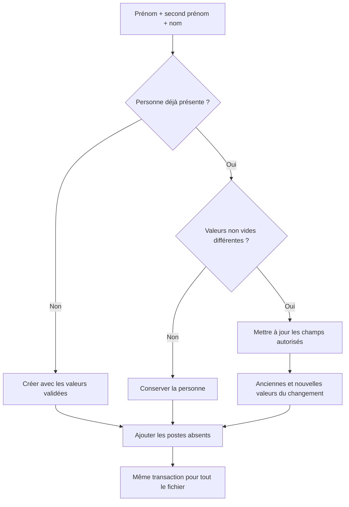
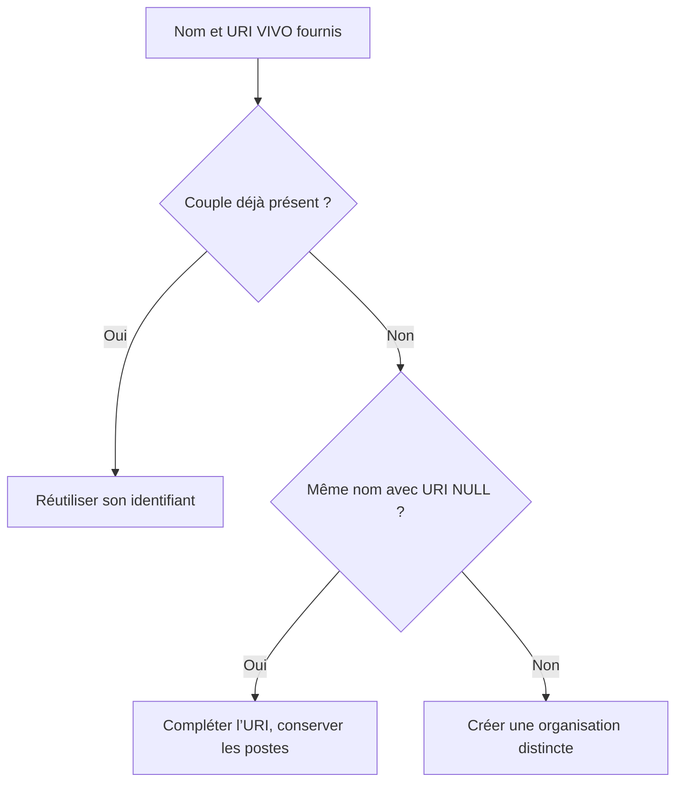

# Traitements et vérifications des données

[Sommaire](README.md) · [Parcours général](fonctionnement.md) · [Configuration des limites](exploitation.md#configuration)

Le schéma cible est fixe. [`app/schema.py`](../app/schema.py) centralise types, défauts, alias, validations et politiques `update` / `history` ; [`app/models.py`](../app/models.py) porte les contraintes SQL. Un nom de fichier ou de feuille ne définit jamais le mapping.

## 1. Lire et identifier les colonnes

| Contrôle | CSV | XLSX |
|---|---|---|
| Reconnaissance | Contenu textuel exploitable ; extension divergente signalée | Archive OOXML et parties requises contrôlées |
| Encodage | BOM UTF-8/16/32, UTF-8 strict, puis candidats occidentaux contrôlés ; vérification de tous les octets | Déclarations/BOM des XML internes interprétés automatiquement |
| Séparation | Détection de `,`, `;`, tabulation ou `|` ; guillemets et champs multilignes respectés | Cellules et types natifs conservés |
| Structure | Largeur des enregistrements contrôlée | Feuilles choisies, cellules d’erreur/formules refusées |
| Protections | Aucun remplacement silencieux de caractère | Limite décompressée, maximum 1000 entrées ZIP, macros/contenus binaires refusés |

Le contenu prévaut sur l’extension. Un encodage ou un séparateur non déterminable exige une option explicite, toujours validée. Les options CSV ne sont pas applicables à XLSX.

La recherche d’en-tête porte par défaut sur 20 lignes, à partir des alias connus et du mapping fourni. `header_row` précise sa ligne ; `0` impose un mapping par positions `@c1`, `@c2`, etc. Plusieurs feuilles nécessitent `sheets`, puis leurs lignes sont concaténées sans jointure.



Les en-têtes sont comparés après normalisation de casse, accents et séparateurs ; les caractères non latins restent distincts. Deux en-têtes normalisés identiques, plusieurs sources pour une même cible ou une source explicitement absente sont refusés. `name`, `title`, `titre`, `date`, `uri` exigent une décision. Une colonne ne peut pas être simultanément mappée et ignorée.

## 2. Nettoyer et valider les valeurs

Les espaces de bord sont supprimés et les suites d’espaces réduites. Une chaîne vide devient NULL. **Les noms de personnes conservent casse et accents.** Aucun effacement n’est demandé implicitement par une colonne absente, une cellule vide ou un mot-clé spécial.

| Cibles | Validation et comportement |
|---|---|
| `person.first_name`, `person.last_name` | Obligatoires, texte non vide |
| `person.middle_name` | Facultatif ; absent/vide → NULL dans la clé d’identité |
| `person.email` | Facultatif ; syntaxe validée par Pydantic/email-validator, sans test de délivrabilité |
| `person.phone`, `person.fax`, `person.title` | Facultatifs, textuels ; les contacts numériques Excel sont refusés pour préserver les zéros initiaux |
| `organization.org_name` | Obligatoire lorsqu’une organisation ou un poste est renseigné |
| `organization.org_vivo_uri` | Texte facultatif conservé après nettoyage ; URI VIVO d’instance ou de catégorie, potentiellement partagée entre organisations |
| `job.job_title`, `job.job_type` | Textes facultatifs ; un poste renseigné exige une organisation |
| `job.start_date` | Date calendaire selon la convention globale ci-dessous |

L’alias `dataFirstNames` est séparé à la première virgule entre prénom et second prénom ; les espaces d’un prénom composé ne sont pas un séparateur. Sans seconde partie, le second prénom est NULL. Les alias `raw_first` / `raw_middle` désignent des champs déjà séparés.

Les champs textuels canoniques sont limités à 2048 caractères. Une valeur optionnelle non vide invalide est une erreur, jamais un NULL de remplacement. Les lignes entièrement vides ne sont pas comptées.

## 3. Interpréter les dates sur tout le fichier



- Les dates numériques complètes partagent une convention : une date **valide** avec jour >12 établit DMY ou MDY, même si elle arrive en dernière ligne ou dans une autre feuille sélectionnée.
- Si toutes les composantes jour/mois restent ≤12, l’ordre est refusé ; aucun profil ou défaut ne force le choix.
- Les années `YY`, les preuves contradictoires et les conventions/séparateurs complets mélangés sont refusés. Une date impossible ne sert jamais de preuve.
- ISO `YYYY-MM-DD` et les dates Excel réellement typées sont explicites ; un nombre brut Excel n’est pas interprété comme numéro sériel de date.
- Une année seule nécessite `year_policy="january_first"`. Les alias de référence `dataJobStartDate` / `raw_date` déclarent déjà cette convention ; `year_policy="reject"` permet de la refuser. La précision ajoutée est signalée.

La base conserve un `DATE` natif ; la sérialisation métier utilise `DD/MM/YYYY`, les timestamps techniques UTC. Pour une consultation SQL : `to_char(start_date, 'DD/MM/YYYY')`. Les réponses d’import exposent un bilan, pas une liste des postes et de leurs dates.

## 4. Rapprocher, mettre à jour et historiser



**Personne.** La clé exacte est `(first_name, middle_name, last_name)` ; l’unicité PostgreSQL considère les NULL comme identiques. Un email partagé ne fusionne pas des personnes. Les homonymes exacts restent une limite de cette clé, sans rapprochement approximatif ni changement silencieux de nom.

**Mise à jour.** Seuls les champs `update=true` sont remplacés par une valeur non vide : actuellement email, téléphone, fax et titre. Exemple : un import sans téléphone, ou avec téléphone vide, conserve celui déjà stocké. Deux lignes compatibles de la même identité peuvent compléter des coordonnées et ajouter plusieurs postes ; des coordonnées contradictoires annulent tout le fichier.

**Organisation.** Les alias `dataURI` / `raw_uri` alimentent `organization.org_vivo_uri`, sans exclusion des URI de catégories comme `http://vivoweb.org/ontology/core#Department`. L’API conserve la valeur ; elle ne consulte pas l’ontologie ni ne déduit le sens d’une URI par sa forme. Deux noms différents ne sont jamais rapprochés sur la seule URI.

Avec une URI, le couple **nom exact + URI** identifie l’organisation ; une contrainte SQL empêche les doublons, NULL compris. Sans correspondance exacte, une organisation de même nom dont l’URI est NULL peut être enrichie, en conservant son identifiant et ses postes. Sinon, une nouvelle organisation est créée. Un même nom avec deux URI différentes reste deux organisations distinctes. Sans URI fournie, un nom correspondant à une seule organisation suffit et conserve son URI existante ; plusieurs correspondances provoquent une erreur 409 demandant de préciser l’URI. Les noms conservent casse et accents : les homonymes exacts restent une limite du contrat.



Exemple fictif : `Institut A` et `Institut B` peuvent chacun stocker `…#Department` sans fusion. Cette URI décrit alors leur catégorie commune. Le rôle des catégories et des entités individuelles est illustré dans l’[article VIVO, figure 3, pages 6–7](https://yingding.ischool.utexas.edu/Publication/VIVOOntology.pdf).

**Poste.** Ajouter sans réécrire les postes existants. Clé unique : personne + organisation + titre + type + date, NULL compris. Un poste entièrement vide n’est pas créé. `ON CONFLICT DO NOTHING RETURNING` fournit le nombre réel de postes insérés.

**Historique.** Une modification réelle des champs `history=true` produit anciennes/nouvelles valeurs JSONB, champs changés, personne, lot source et instant UTC. Les champs de contact désactivés pour l’historique sont exclus des snapshots ; la clé d’identité y reste présente. Aucune entrée pour une insertion ou une valeur identique ; une personne créée puis complétée dans le même fichier reste une création. Tout historique est annulé si la transaction échoue.

**Réimport.** Répéter immédiatement un fichier identique ne crée ni doublons ni historique inutile. Réimporter une ancienne source après une plus récente peut rétablir d’anciennes coordonnées : le SHA-256 ne bloque donc pas un nouvel import.

## Faire évoluer un champ

1. Ajouter/modifier la déclaration dans `app/schema.py` : type, valeur par défaut, alias et flags `update` / `history` ; utiliser `Field` ou `field_validator` pour les validations.
2. Si le stockage change, modifier le modèle ORM et ajouter une **nouvelle** migration Alembic revue. Un alias ou une règle purement applicative ne modifie pas SQL.
3. Tester création, mise à jour, absence/vide, historique et rollback. Changer la clé d’identité ou d’unicité d’un poste nécessite une décision métier explicite.

Exemple de contact facultatif :

```python
mobile: str | None = Field(
    default=None,
    json_schema_extra={"aliases": ["mobile", "cellphone"], "update": True, "history": True},
)
```

Aucun upload ne modifie le schéma SQL. Supprimer un champ doit tenir compte des données existantes ; les anciens snapshots JSONB ne sont pas réécrits. Les diagnostics disponibles et codes HTTP sont décrits dans [Fonctionnement](fonctionnement.md#contrat-http).
