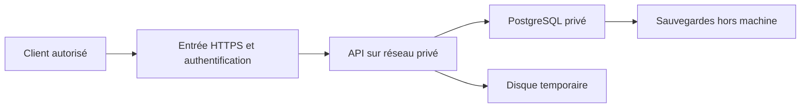
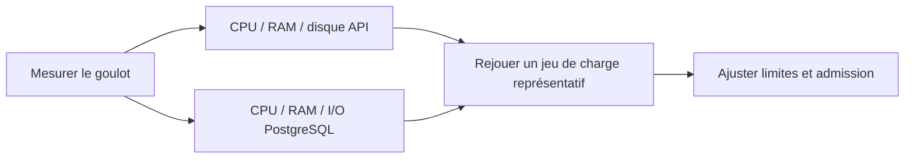
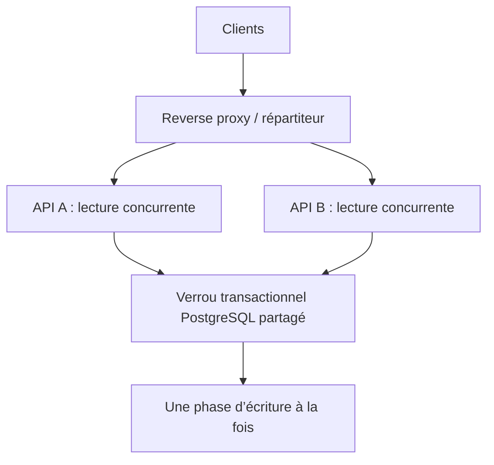

# Exploitation, configuration et passage à l’échelle

[Sommaire](README.md) · [Installation Windows/Linux](../README.md#installer-et-démarrer-avec-docker) · [Fonctionnement](fonctionnement.md)

## Déployer la solution

Le Compose fourni déploie une API et PostgreSQL sur une machine, avec ports liés à localhost. Il convient au développement et peut servir de base à un déploiement contrôlé ; **TLS, authentification, autorisations et quotas par client ne sont pas fournis par l’application**.



1. Installer Docker/Compose sur la VM, cloner le dépôt ou déployer une image construite et testée. Dimensionner **ensemble** API, PostgreSQL, disque et système.
2. Fournir les variables/secrets hors Git ; activer `ENVIRONMENT=production`, changer le mot de passe SQL et mettre à jour `DATABASE_URL` avec les mêmes identifiants. Encoder les caractères réservés du mot de passe dans l’URL.
3. Mettre un reverse proxy ou une passerelle devant l’API : HTTPS, authentification, contrôle d’accès, limites et délais de réception. Garder SQL privé. Le port API local peut être utilisé par un proxy sur l’hôte ; un proxy conteneurisé doit partager un réseau et joindre `api:8000`.
4. Démarrer avec `docker compose up --build -d --wait`, contrôler `/health`, puis effectuer un import **synthétique** et son réimport. `/health` prouve la connexion SQL, pas toute la capacité métier.
5. Configurer sauvegardes, restauration testée, supervision et rétention des lots/historiques. Définir les procédures de livraison et d’incident avant exposition publique.

Le mode production refuse uniquement une connexion sans mot de passe ou avec le mot de passe de développement : il ne réalise pas un durcissement complet. Les variables d’environnement sont injectées dans le conteneur ; le dépôt ne contient pas de gestionnaire de secrets. Pour une base distante, adapter `DATABASE_URL`, la validation TLS du client PostgreSQL et les certificats montés selon l’hébergement.

Au démarrage, le conteneur applique Alembic puis lance Uvicorn, sous un utilisateur non-root. Le compte SQL doit donc actuellement pouvoir migrer le schéma. Pour séparer les droits DDL et applicatifs, exécuter un job de migration dédié et surcharger la commande API pour ne lancer qu’Uvicorn ; ce découpage est à intégrer au déploiement. Les tags Docker peuvent recevoir des mises à jour : figer les digests si une reproductibilité système stricte est nécessaire.

## Configuration

`.env` est facultatif pour le développement. Compose l’utilise pour ses substitutions ; Python lit son environnement et, hors Docker, le fichier `.env`. Les options ci-dessous sont transmises au conteneur API. Recréer le conteneur après modification : `docker compose up -d --build api`.

| Variable | Défaut | Effet |
|---|---:|---|
| `ENVIRONMENT` | `development` | Garde de configuration du mot de passe en production |
| `DATABASE_URL` | PostgreSQL local/de développement | URL SQLAlchemy `postgresql+psycopg://...` ; hôte `db` en Compose, `127.0.0.1` depuis l’hôte |
| `POSTGRES_DB`, `POSTGRES_USER`, `POSTGRES_PASSWORD` | Voir `.env.example` | Initialisation du service SQL, à coordonner avec l’URL |
| `API_PORT`, `POSTGRES_PORT` | `8000`, `5432` | Ports hôte liés à localhost |
| `MAX_UPLOAD_BYTES` | `10485760` | Fichier maximal : 10 Mio ; enveloppe HTTP limitée avec 64 Kio de marge |
| `MAX_XLSX_UNCOMPRESSED_BYTES` | `52428800` | Contenu ZIP décompressé maximal : 50 Mio |
| `MAX_ROWS`, `MAX_COLUMNS` | `100000`, `256` | Lignes sélectionnées / colonnes admises |
| `MAX_HEADER_ROWS` | `20` | Fenêtre automatique de recherche d’en-tête |
| `MAX_RECORD_BYTES` | `1048576` | Taille UTF-8 maximale d’un enregistrement source |
| `MAX_ERRORS` | `50` | Borne des diagnostics ; erreurs/avertissements tronqués signalés |
| `MAX_ACTIVE_UPLOADS` | `2` | Requêtes d’import simultanées **par processus** ; refus 429 avant multipart |
| `IMPORT_TIMEOUT_SECONDS` | `900` | Budget de traitement après parsing multipart, contrôlé entre lignes et avant SQL |
| `DATABASE_LOCK_TIMEOUT_SECONDS` | `5` | Attente maximale d’un verrou SQL ; conflit 409 |
| `API_MEMORY_LIMIT_MIB` | `2048` | Plafond Docker de mémoire **par conteneur API**, pas une réservation |
| `API_CPU_LIMIT` | `1.0` | Quota Docker de CPU logique équivalent par conteneur |

La mémoire/swap et le CPU sont appliqués par Compose, pas par les paramètres Python. Hors Docker, utiliser des mécanismes système pour des limites dures. Le plafond API exclut PostgreSQL et l’hôte ; il ne suffit pas d’avoir 2 Gio sur toute la VM. Augmenter la RAM ne relève pas automatiquement les limites de fichiers, et inversement.

Le spool conserve au plus 64 Kio avant passage sur disque ; l’image utilise `/service/tmp`, monté sur un volume disque. Aucun quota applicatif de disque temporaire ou de mémoire par requête n’est implémenté : surveiller l’espace libre et dimensionner le nombre d’uploads. Ne pas remplacer ce volume par un tmpfs si l’objectif est d’économiser la RAM.

Un cache de personnes limité à 1000 entrées par import réduit les recherches répétées ; il disparaît à la fin de la requête. Les identités déjà rencontrées restent suivies pour détecter les contradictions du fichier, avec une mémoire proportionnelle à sa taille admise. Il n’existe ni cache partagé entre instances ni cache durable de résultats d’import.

Configurer la taille admise au proxy pour le fichier **et** l’enveloppe multipart. Le délai de lecture de réponse doit tenir compte du budget d’import et de la réception ; une déconnexion ou un timeout du proxy ne garantit pas l’annulation d’un thread d’import déjà lancé. Une bibliothèque native n’est pas interrompue à mi-appel ; Docker reste une protection ultime, sans promesse d’absence d’OOM.

## Schéma initial et migrations

Une base neuve s’initialise avec **`0001_v1`**, puis applique **`0002_shared_vivo_uri`**. La première crée les cinq tables actives et la table de version Alembic ; la seconde remplace l’unicité de l’URI seule par celle du couple nom + URI. Aucune donnée n’est préchargée ni supprimée lors de cette évolution.


Commandes communes PowerShell/Bash, avec l’environnement Python actif pour les commandes locales :

```sh
docker compose exec api alembic current
docker compose exec api alembic history
docker compose exec api alembic upgrade head
# Générer sur l’hôte, DATABASE_URL visant une base de développement
python -m alembic revision --autogenerate -m "add person mobile"
python -m alembic upgrade head
```

Alembic versionne **le schéma** ; `person_history` conserve **les changements de valeurs métier**. Ajouter une colonne/contrainte SQL demande une migration, ajouter un alias de fichier n’en demande pas. Une fois la V1 publiée et utilisée, conserver ses révisions et ajouter les suivantes ; ne pas recommencer une remise à zéro sur une base exploitée.

Sur une base déjà en `0001_v1`, `upgrade head` applique uniquement la correction d’unicité et conserve les identifiants, relations, lots et historiques. Les URI auparavant ignorées ne peuvent pas être reconstituées par une migration : réimporter les sources pour enrichir les organisations sans URI. Un retour vers `0001_v1` échoue sans suppression de données si plusieurs organisations partagent désormais une URI ; l’ancien schéma ne peut pas représenter ce cas.

Cette initialisation n’est pas une conversion automatique d’une base issue d’une autre chaîne de migrations. Ne pas utiliser `alembic stamp` pour faire passer un schéma incompatible pour une base V1. Pour une installation existante à conserver, préparer une transition et une restauration sur une base distincte.

Pour repartir volontairement de zéro en **développement uniquement**, la commande suivante efface les volumes du projet courant, donc toutes ses données SQL et temporaires :

```sh
docker compose down --volumes
docker compose up --build -d --wait
```

Vérifier le répertoire et le nom de projet Compose avant cette commande. Un arrêt habituel utilise `docker compose down` sans suppression de volume. Changer `POSTGRES_*` après initialisation ne modifie pas les rôles ou mots de passe existants.

## Sauvegardes et diagnostic

Exemple à adapter au compte et à la base configurés ; la copie hors dépôt évite de publier des données personnelles. `pg_dump -f` évite aussi la redirection binaire fragile selon la version de PowerShell.

```sh
docker compose exec -T db pg_dump -U ingestion_user -d ingestion_db -Fc -f /tmp/ingestion.dump
docker compose cp db:/tmp/ingestion.dump ../ingestion.dump
docker compose logs --tail 100 api
```

Tester la restauration dans une base isolée. Le volume PostgreSQL n’est pas une sauvegarde. Suivre au minimum : taux d’erreurs, délais et compteurs d’import, 409/429/503, CPU/RAM, espace temporaire, connexions SQL et attente du verrou d’import. La V1 ne fournit pas d’endpoint de métriques. Les logs applicatifs évitent les cellules et détails SQL sensibles ; examiner aussi les logs PostgreSQL/proxy et leurs règles de conservation.

## Passage à l’échelle

### Vertical : renforcer une instance



Augmenter CPU/RAM peut aider lecture et validation ; augmenter le budget d’uploads augmente aussi la mémoire et le disque simultanés. Optimiser les I/O et les requêtes SQL si elles dominent. La transaction et le dictionnaire des identités restent proportionnels au fichier admis ; relever `MAX_ROWS` ou la limite ZIP exige une nouvelle mesure. Le quota CPU n’est pas la promesse d’un cœur dédié.

### Horizontal : plusieurs instances



Les instances sont compatibles si elles utilisent **la même base et le même contrat** : le verrou PostgreSQL sérialise les écritures et les contraintes protègent l’unicité. Cela améliore disponibilité et réception/parsing concurrent, **pas le débit parallèle des écritures**. La clé de verrou est partagée à l’échelle de la base PostgreSQL, y compris entre ses schémas ; elle ne dépend pas d’une mémoire locale de l’API.

Le Compose fourni publie un port API fixe : `--scale api=2` seul provoque un conflit de port. Adapter le déploiement pour que seul le proxy publie un port et que les API restent privées. Prévoir un disque temporaire inscriptible par instance, la même configuration SQL, des migrations coordonnées et des limites de ressources pour chaque réplique.

Chaque processus possède son admission et son pool SQLAlchemy. Avec les paramètres par défaut du pool synchrone, compter jusqu’à 5 connexions conservées + 10 de débordement par processus, à multiplier par les processus/répliques, puis ajouter les autres clients. Les paramètres du pool ne sont pas actuellement exposés en variables d’environnement : toute adaptation se fait dans `app/database.py` et doit être testée. Voir la [documentation du pool](https://docs.sqlalchemy.org/en/20/core/pooling.html).

Si l’attente du verrou limite réellement le débit, ajouter des API ne suffit plus : envisager des verrous plus fins, un partitionnement ou des opérations par lots avec tests de concurrence. Ces travaux, et les jobs asynchrones éventuels, sont détaillés dans les [évolutions possibles](choix_et_evolutions.md#fonctionnalités-possibles).
