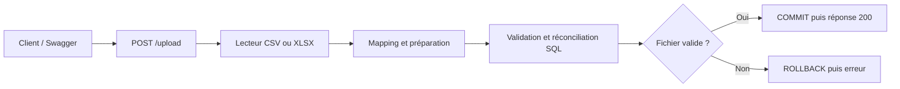
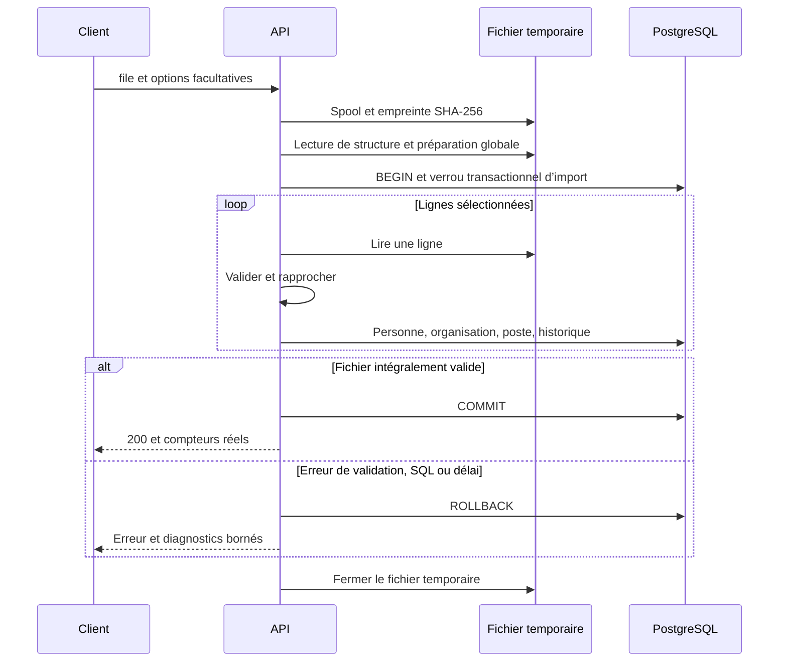
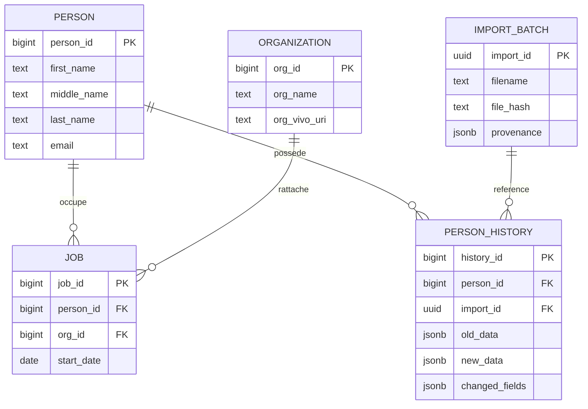

# Fonctionnement de l’API

[Sommaire](README.md) · [Règles de données](donnees.md) · [Exploitation](exploitation.md)

## Vue d’ensemble

`POST /upload` reçoit un fichier CSV ou XLSX et, si nécessaire, des options JSON dans le formulaire multipart. Il crée ou rapproche les personnes, leurs organisations et leurs postes. Le résultat est synchrone : une réponse de succès signifie que la transaction est validée.

La préparation et la validation appliquent les [règles de données](donnees.md) : le présent guide décrit leur place dans le parcours, sans les recopier.

## Déroulement d’une requête

| Étape | Rôle | Module |
|---|---|---|
| Réception | Limiter l’admission et le corps multipart ; fichier temporaire standard | `http_limits.py`, `main.py` |
| Lecture | Déterminer le support, extraire en-têtes et lignes | `readers.py` |
| Correspondance | Associer les colonnes au contrat cible | `mapping.py`, `schema.py` |
| Préparation globale | Parcourir la structure et résoudre la convention de date avant écriture | `dates.py`, `importer.py` |
| Transaction | Relire les lignes, valider, rapprocher et historiser | `importer.py`, `models.py` |
| Réponse | Renvoyer compteurs validés ou diagnostics en anglais | `main.py`, `errors.py` |

Une erreur de lecture ou de préparation peut interrompre la requête avant `BEGIN`. Une erreur de ligne peut arriver après des écritures **non validées** : le rollback annule tout le fichier. Aucun import partiel, lot échoué durable ou historique de changement annulé n’est conservé.

## Modèle de données

Le diagramme montre les clés et quelques attributs ; le schéma complet est dans [`app/models.py`](../app/models.py). Le lot conserve la source et le bilan, l’historique référence le lot qui a modifié une personne. Le fichier original n’est pas archivé et aucune relation directe lot → poste n’est enregistrée.

## Contrat HTTP

| Route | Fonction |
|---|---|
| `POST /upload` | Seule route métier |
| `GET /health` | Vérifie l’accès SQL avec `SELECT 1` |
| `/docs`, `/redoc`, `/openapi.json` | Documentation technique |

La réponse de succès contient `import_id`, `rows_processed`, `persons_created`, `persons_updated`, `persons_unchanged`, `jobs_created` et `warnings`. Les compteurs de personnes portent sur des identités distinctes ; les postes sont comptés à partir des insertions SQL effectives. Un nouveau poste peut être ajouté pour une personne inchangée.

Les erreurs contiennent `success=false`, `message`, `errors` et `errors_truncated`. Chaque diagnostic donne le contexte disponible : `code`, `row`, `column`, `sheet`, `message`. Les messages sont en anglais, sans valeur de cellule rejetée ni stack trace.

| HTTP | Sens |
|---|---|
| 400 / 422 | Requête incorrecte / fichier, mapping ou valeurs à corriger |
| 413 / 415 | Limite dépassée / contenu non pris en charge |
| 409 | Contrainte, organisation ambiguë ou verrou SQL occupé |
| 429 | Admission saturée, avec `Retry-After` |
| 503 / 500 | Indisponibilité ou délai / erreur interne |

Le contrat des options et les exemples d’appels sont dans le [README principal](../README.md#appeler-upload). Les règles exactes de conversion et de mise à jour figurent dans [Données](donnees.md).
